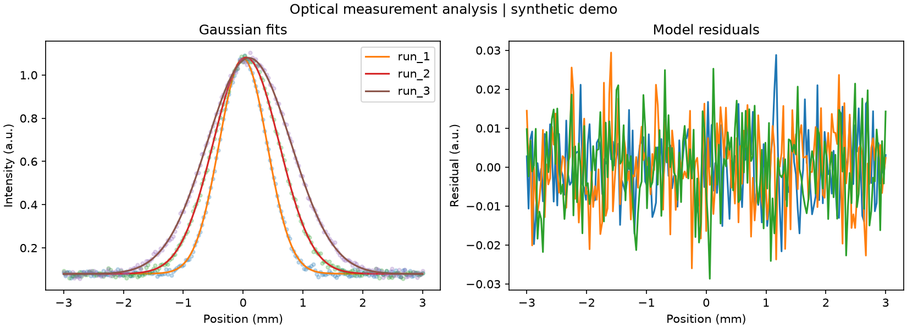

# Optical measurement automation — OptiIA Consulting

CSV batch analysis of one-dimensional Gaussian beam profiles with fit diagnostics.

**New portfolio demonstration, November 2026. Synthetic data only; not a client engagement, clinical tool or validated industrial deployment.** No employer or client code/data are included.



## Run

Python 3.12 recommended. From this repository:
```bash
python -m venv .venv
# Windows: .venv\Scripts\activate
# Linux/macOS: source .venv/bin/activate
python -m pip install -r requirements.txt
python -m unittest -v test_analysis
python analysis.py --seed 42 --out results
```

For your own CSV (local processing):
```bash
python analysis.py --csv measurements.csv --out results
```

The command regenerates data and writes results locally. The root `metrics.json` and `preview.png` are the checked-in seed-42 example. Generated arrays/CSV remain in `results/` and are not required to reproduce the demo.

## Method and measured example

1. Read CSV columns run_id, position_mm, intensity_au; group and sort measurements by run.
2. Fit offset + amplitude * exp(-(x-center)^2/(2*sigma^2)) by bounded nonlinear least squares.
3. Report centre, sigma, FWHM = 2*sqrt(2*ln(2))*sigma, residual RMSE and covariance-derived FWHM standard error.
4. Export JSON metrics, a CSV summary and fit/residual plots.

Seed 42 fitted FWHM values: **0.942694, 1.296294, 1.652825 mm**. The corresponding synthetic sigma values are 0.40, 0.55 and 0.70 mm.

## Validation

Four automated tests passed on 3.12.14, NumPy 2.5.3, SciPy 1.18.1, Matplotlib 3.11.2, on 10 November 2026. See `test_analysis.py`: synthetic truth checks and invalid-input tests. No real-world accuracy claim is made.

## Assumptions and limits

The model assumes a single Gaussian profile and additive independent noise. Covariance-based standard error is conditional on that model and does not include position calibration or instrument uncertainty. This is not an ISO beam-quality measurement, an M-squared estimate or hardware control. Multimodal, saturated or truncated profiles require a different model and quality checks.

## Relation to OptiIA activities

This illustrates a possible scoped service in scientific analysis and Python automation. A real project requires representative input data, agreed acceptance criteria and independent validation. Classical baselines are used here; this repository does not claim to train an AI model.

## Portfolio

See [Ali Yaghi's portfolio](https://github.com/yaghi-ali) for separate optical simulation and signal-processing projects. This demo is independent of those repositories.

OptiIA Consulting · contact@optiia-consulting.fr · https://www.optiia-consulting.fr
